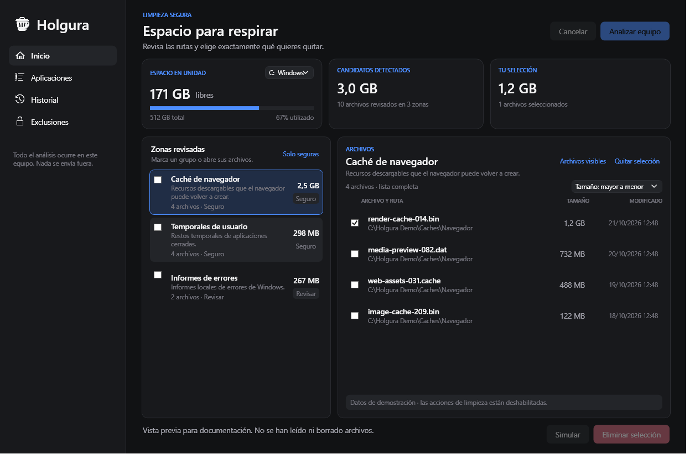
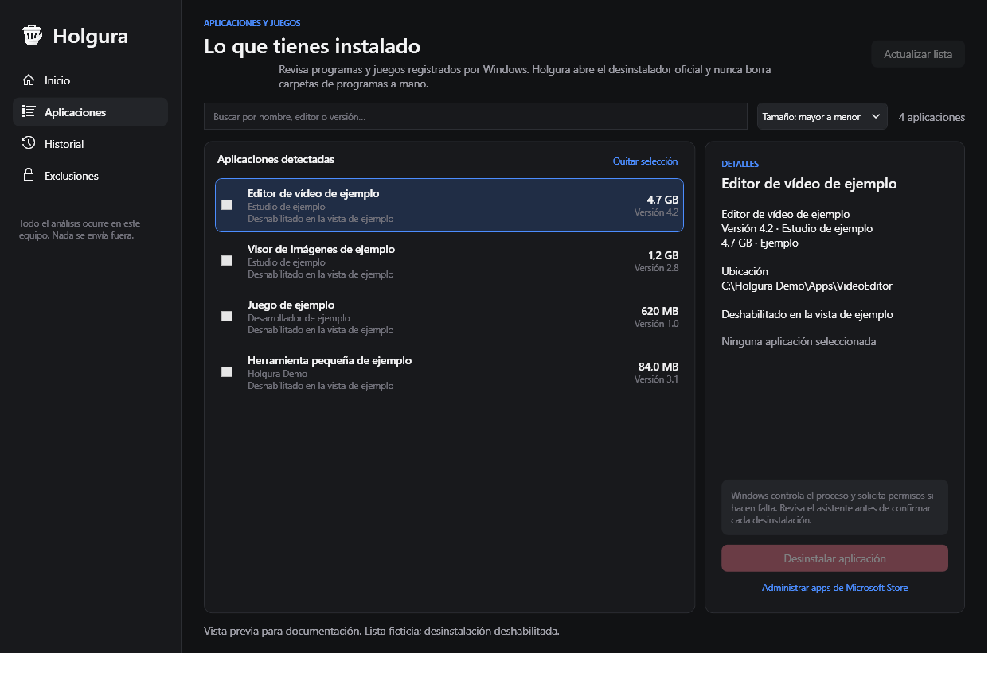

<p align="center">
  
</p>

<h1 align="center">Holgura</h1>

<p align="center">
  <strong>Espacio para respirar.</strong><br/>
  Limpiador para Windows y WSL que enseña los archivos, rutas y tamaños antes de borrarlos.
</p>

<p align="center">
  <a href="https://github.com/smouj/holgura/actions/workflows/ci.yml"></a>
  <a href="https://github.com/smouj/holgura/releases"></a>
  
  
  
  
</p>

---

## Vista previa

Las capturas usan datos ficticios; las acciones de limpieza y desinstalación están deshabilitadas.
El modo de muestra solo se compila en Debug y no está incluido en la aplicación distribuida (Release).

<p align="center">
  
</p>

<p align="center">
  
</p>

## Por qué otro limpiador

La mayoría pide confianza y devuelve una barra de progreso. Holgura devuelve la lista de archivos:
cada categoría, su tamaño, su ruta y el motivo por el que puede irse.

- Todo borrado pasa por una única puerta que revalida raíz, exclusiones y archivo.
- Las raíces críticas (unidades, `Windows`, `Program Files`, tu perfil, Documentos, Escritorio) nunca pueden ser raíz de borrado.
- Los junctions y puntos de reanálisis no se siguen jamás.
- Un archivo bloqueado se omite y se reporta; no es fatal.
- Los grupos se muestran con tamaño, riesgo y número de archivos; puedes revisar y marcar varios archivos concretos.
- Los archivos se ordenan por tamaño ascendente o descendente y por nombre; la lista de zonas prioriza las que ocupan más espacio.
- **Simular** enseña el plan sin borrar nada; **Eliminar selección** pide confirmación y vuelve a comprobar cada archivo.
- Project Infest queda protegido en el análisis y en la puerta de borrado; sus rutas y aplicaciones no se pueden seleccionar.
- El panel muestra el espacio libre y usado de las unidades fijas disponibles.

## Qué limpia

| Módulo | Nivel | Notas |
|---|---|---|
| Temporales del usuario (`%TEMP%`) | Seguro | Se regeneran |
| Temporales de Windows (`\Windows\Temp`) | Revisar | Parte requiere administrador; el resto se omite y se reporta |
| Caché de miniaturas | Seguro | Explorer la reconstruye |
| Informes de errores (WER) | Seguro / Revisar | Usuario y cola del sistema |
| Volcados de fallos | Seguro / Revisar | `CrashDumps` y `Minidump` |
| Cachés de navegador | Seguro | Chrome, Edge, Brave, Vivaldi y Firefox: solo caché |
| Papelera de reciclaje | Revisar | Nunca preseleccionada; se vacía por la API del shell |
| Cachés dentro de WSL | Seguro / Revisar | apt, journald, pip, npm, uv por distro |

La vista de archivos conserva los 2.000 archivos más grandes por zona para que el análisis no
consuma memoria sin límite. Cuando una zona tiene más archivos, se indica cuántos quedan fuera de
la vista; seleccionar la zona completa incluye todos sus candidatos. La selección individual solo
alcanza los archivos visibles y compara tamaño y fecha con el análisis antes de borrar.

## Aplicaciones y juegos instalados

La pestaña **Aplicaciones** lee las entradas de desinstalación de Windows para el equipo y el
usuario actual, incluidas las vistas de registro de 32 y 64 bits. Muestra editor, versión, tamaño
estimado y ruta de instalación cuando Windows los informa. Puedes ordenar por tamaño o nombre,
filtrar por nombre, editor, versión o unidad y ver en qué disco está cada entrada. Si Windows no
indica una ruta, aparece como **Unidad no informada**. Puedes seleccionar varias aplicaciones; Holgura abre sus
desinstaladores oficiales uno a uno y te pide confirmar antes de continuar con el siguiente. La
secuencia se puede detener, y Holgura nunca borra manualmente una carpeta de programa. Los
componentes del sistema se ocultan y las entradas de Project Infest quedan bloqueadas.
Los desinstaladores que dependen de scripts o intérpretes de comandos se bloquean por seguridad.
Las aplicaciones de Microsoft Store se administran desde el botón que abre Configuración de Windows.

## Ventana adaptable

Holgura detecta el área útil del monitor donde se abre, centra la ventana dentro de ese espacio y
ajusta sus límites para respetar la resolución, el escalado DPI y la barra de tareas. Al reducir
la ventana, la navegación lateral se compacta y conserva sus iconos y descripciones emergentes.

### Lo que nunca toca

Cookies, historial, contraseñas, sesiones, extensiones, marcadores, descargas, documentos,
proyectos, Project Infest, `Program Files` y cualquier ruta que añadas a la lista de exclusiones.

## Modelo de seguridad

```
ESCANEAR -> VALIDAR -> SELECCIONAR -> VALIDACIÓN PREVIA -> BORRAR -> VERIFICAR -> REPORTAR
```

1. Un módulo solo declara un directorio raíz. Nunca recibe permiso de borrado.
2. `PathSafetyValidator` rechaza raíces de unidad, carpetas protegidas y cualquier raíz que las contenga.
3. `CleanupGate` revalida contención, exclusiones, puntos de reanálisis y existencia justo antes de borrar.
4. Cada archivo individual seleccionado se compara por ruta, tamaño y fecha con la vista previa; si cambió, se conserva.
5. Un archivo más nuevo que el escaneo (más 5 minutos de margen) se marca `ChangedSinceScan`.
6. Un fallo en un archivo se registra y la operación continúa.
7. Los candidatos se procesan en lotes de 512 para no inflar la memoria en equipos ya justos.

La papelera y WSL son `DeletionScope.External`: el motor les entrega una puerta que **rechaza**
cualquier borrado de archivo, y solo pueden ejecutar su propia operación acotada.

## WSL

Windows no ve dentro de `ext4.vhdx`, así que WSL va por su propio camino:

- `IWslBridge` ejecuta `wsl.exe` con lista de argumentos, nunca una cadena de shell compuesta.
- La medición envía un script fijo por la entrada estándar de Bash para evitar problemas de comillas y finales de línea entre Windows y WSL; informa bytes y número de archivos por caché.
- Una medición fallida **es un error**, no un resultado vacío: la app nunca dice "no hay nada" cuando no pudo mirar.
- La limpieza solo ejecuta recetas fijas de `WslRecipes`; lo que no está en la lista se resuelve a `null` y falla cerrado.
- Las cachés de usuario se limpian directamente; `apt` y `journald` exigen `sudo` sin contraseña y se reportan cuando no está.

Liberar espacio dentro de una distro no encoge el VHDX. Compactarlo requiere `wsl --shutdown` y
`Optimize-VHD` con permisos de administrador, y la app lo dice en vez de fingir que lo ha hecho.

## Instalación

Holgura se publica como aplicación autocontenida: no tienes que instalar .NET por separado. El
flujo de publicación prepara `Holgura-Setup-win-x64.exe`, una instalación para tu usuario que crea
accesos en el menú Inicio y, por defecto, en el escritorio; al terminar puede abrir la app. El ZIP
portable sigue disponible para quien prefiera descomprimir y ejecutar. La release
[v1.1.0](https://github.com/smouj/holgura/releases/tag/v1.1.0) incluye ambos formatos.

1. Descarga [Holgura-Setup-win-x64.exe](https://github.com/smouj/holgura/releases/download/v1.1.0/Holgura-Setup-win-x64.exe) e instala para tu usuario.
2. Para la versión portable, descarga [Holgura-win-x64.zip](https://github.com/smouj/holgura/releases/download/v1.1.0/Holgura-win-x64.zip), descomprímelo donde quieras y ejecuta `Holgura.App.exe`.

El instalador no tiene firma digital de editor; Windows puede mostrar un aviso de SmartScreen al abrirlo.

Diagnóstico en `%LOCALAPPDATA%\Holgura\app.log`.

## Compilar

Requiere el SDK de .NET 10 en Windows.

```powershell
dotnet restore
dotnet build -c Release
dotnet test tests/Holgura.Core.Tests/Holgura.Core.Tests.csproj -c Release
dotnet test tests/Holgura.Engine.Tests/Holgura.Engine.Tests.csproj -c Release
dotnet publish Holgura.App/Holgura.App.csproj -c Release -r win-x64 --self-contained true
```

## Arquitectura

```
Holgura.Contracts/            Interfaces, resultados y niveles de seguridad. Sin dependencias.
Holgura.Core/                 PathSafetyValidator, exclusiones, historial, formato.
Holgura.Engine/               Pipeline de escaneo/limpieza, CleanupGate, módulos.
Holgura.Platform.Windows/     Sistema de ficheros, puente WSL, papelera, rutas.
Holgura.App/                  Shell de escritorio (WPF, MVVM), espacio y aplicaciones.
installer/                    Instalador autocontenido por usuario para las releases.
assets/                       Logos para tema claro/oscuro e icono de Windows.
docs/screenshots/              Capturas de demostración con datos ficticios.
tests/
  Holgura.Core.Tests/
  Holgura.Engine.Tests/
tools/SmokeTest/              Escaneo y simulación sin interfaz contra la máquina real.
```

El motor no sabe nada de la interfaz, y la interfaz no sabe nada de las reglas de borrado.

### Nota sobre el shell

La primera iteración apuntó a WinUI 3. Compilarlo exige las tareas *Appx* de MSBuild que solo
vienen con el workload "Windows application development" de Visual Studio. La capa XAML usa WPF
sobre .NET 10, que compila solo con el SDK. Todo lo que hay debajo de `Holgura.App` es idéntico:
cambiar de shell es un cambio de un solo proyecto.

## Verificación

36 pruebas unitarias (18 de Core y 18 de Engine) cubren el validador y el motor: archivos
bloqueados o modificados, puntos de reanálisis, raíces protegidas, simulaciones, cancelación,
selección individual y protección de Project Infest. `tools/SmokeTest` ejecuta un escaneo local y
una simulación sin borrar archivos.
Los resultados de espacio varían según el equipo y no se publican en este README.

## Hoja de ruta

- **v1.0** motor, siete limpiadores, WSL, simulacro, historial, tests y CI ✅
- **v1.1.0** interfaz adaptable, inventario de aplicaciones por unidad, selección múltiple,
  instalador por usuario, documentación y protección de Project Infest ✅
- **v1.2** analizador de almacenamiento por carpetas y cachés de desarrollo (NuGet, npm, pnpm,
  Yarn, pip, Gradle, Cargo, VS Code)
- **v1.3** modo administrador opt-in para `Windows\Temp` y `Minidump`
- **v2.0** shell WinUI 3 cuando el toolchain esté disponible

## Contribuir

Lee [CONTRIBUTING.md](CONTRIBUTING.md). Seguridad: [SECURITY.md](SECURITY.md).

## Privacidad

Todo ocurre en local. Sin cuenta, sin servidor, sin analítica, sin comprobación de actualizaciones
que reporte uso. Tus nombres de archivo no salen de la máquina.

## Licencia

MIT — ver [LICENSE](LICENSE).
